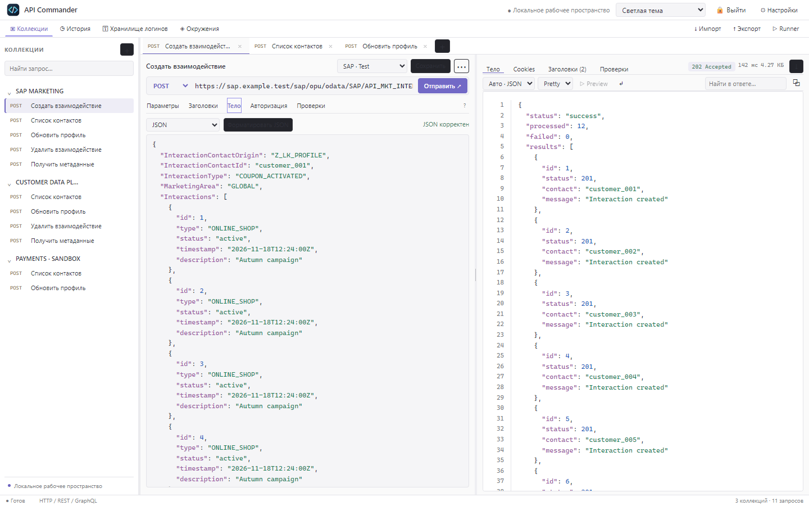
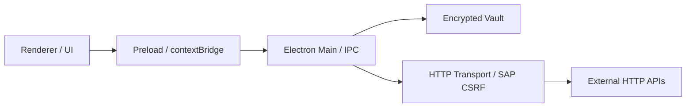

# API Commander

[🇷🇺 Русский](README.md) · **🇬🇧 English**

**API Commander** is a local-first desktop HTTP API client for Windows, built for everyday API workflows: requests, environments, collections, authentication, and SAP OData integrations — without a mandatory cloud account.

**Version:** 2.1.0 · **Platform:** Windows · **Stack:** Electron, Node.js, JavaScript, HTML, CSS

## Download

**[Download the latest Windows version →](https://github.com/evgsnr/api-commander/releases/latest)**

The Portable Windows build is available under [Releases](https://github.com/evgsnr/api-commander/releases). Extract the ZIP archive and run `API Commander.exe`.

## Screenshots

### Dark theme

### Light theme

### Compact layout

## Features

- **HTTP/HTTPS:** GET, POST, PUT, PATCH, DELETE, HEAD, OPTIONS; query parameters, headers, timeouts, cancellation, and redirects.
- **Collections and environments:** nested folders, `{{name}}` variables, and request history.
- **Authentication:** Basic, Bearer, API Key, and locally stored credential profiles scoped to collections.
- **SAP Marketing / OData:** automatic or manual CSRF-token fetching, cookie sessions, and token caching.
- **Request bodies:** JSON, text/XML, URL-encoded forms, GraphQL queries/variables, multipart, and binary files.
- **Responses:** formatting, highlighting, search, headers, cookies, and HTML preview.
- **Import:** Postman Collection v2, Postman environments, OpenAPI JSON, cURL, and native workspaces.
- **Assertions and Runner:** declarative response checks and sequential collection execution.
- **Local storage:** encrypted workspace, manual lock, and configurable auto-lock.

## Version 2.1.0 — Calm UI

A compact interface with light/dark themes, muted accents, more editor space, and adaptive request/response panels.

## Architecture

The renderer handles the UI and request workspace. Preload exposes a limited bridge. Main handles privileged operations. Vault manages local encrypted storage, while Transport and Engine handle HTTP requests, cookies, authentication, CSRF, and response assertions. No separate server or cloud sign-up is required.

## Installation

The Windows Portable build is designed to run after extracting its archive. Keep the application files together and preserve user data when upgrading.

> The current build is available under [Releases](https://github.com/evgsnr/api-commander/releases).

## Limitations

API Commander is not a full Postman replacement: OAuth 2.0 flows, gRPC, WebSocket, cloud sync, and Postman script execution are not implemented. OpenAPI JSON import has limited schema support; there is no dedicated OData batch builder.

**Security:** source documentation describes AES-256-GCM local encryption with scrypt key derivation. This does not imply an independent security audit. Unsaved drafts may be lost after crashes, and forgotten passwords cannot be recovered.

## Development approach

API Commander was built using **AI-assisted development**. The author led the product concept, requirements, architecture, development orchestration, and validation, while AI agents implemented code.

