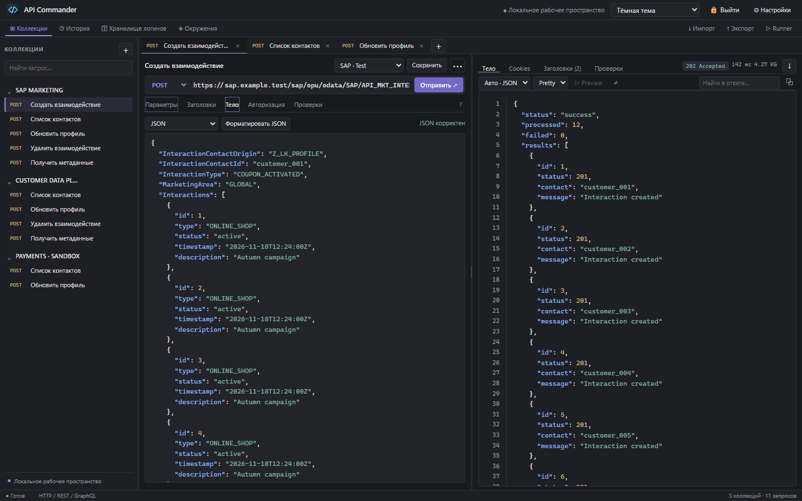
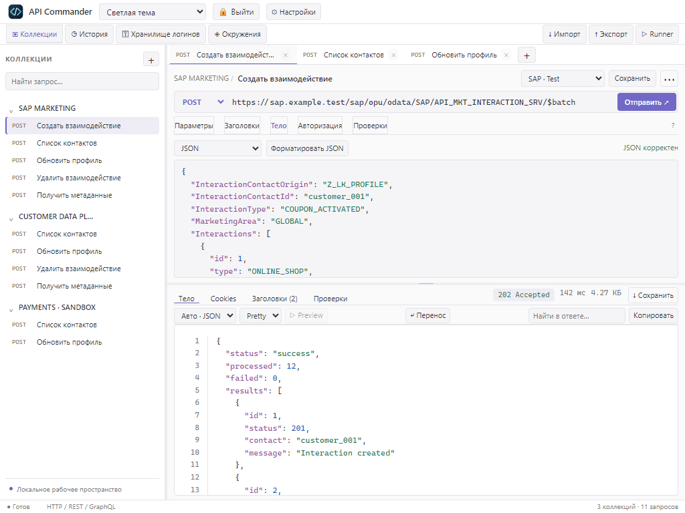
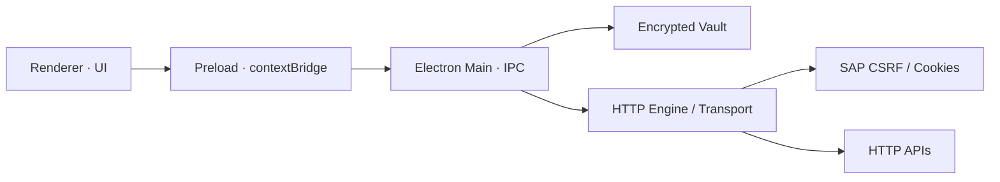

# API Commander

[Русский](README.md) · **English**

API Commander is a small desktop client for working with HTTP APIs.

I work with integrations and APIs regularly, so I wanted a tool for the things I do most often: sending requests, organizing collections, switching environments, and working with SAP OData.

It runs on Windows, keeps data locally, and doesn't require an account. I decided to share it in case someone else finds it useful.

**[⬇ Download API Commander for Windows](https://github.com/evgsnr/api-commander/releases/latest)** · [All releases](https://github.com/evgsnr/api-commander/releases)

## Interface

| Dark theme | Light theme |
|:---:|:---:|
|  |  |

Compact layout

## Why I made it

- **Everyday HTTP API work:** requests, parameters, headers, bodies, and response inspection.
- **System analysis workflows:** collections, environments, `{{name}}` variables, history, and importing existing requests.
- **SAP Marketing / OData integrations:** CSRF-token prefetching, cookie handling, and token reuse.
- **Local workspaces:** no mandatory cloud sync or remote account.

## Features

| Area | Implemented |
|---|---|
| HTTP | GET, POST, PUT, PATCH, DELETE, HEAD, OPTIONS; timeouts, cancellation, redirects |
| Request bodies | JSON, XML/text, URL-encoded, GraphQL over HTTP, multipart, binary files |
| Authentication | Basic, Bearer, API Key; Basic credential profiles |
| Organization | Collections, nested folders, environments, search, history, drag-and-drop |
| Import | Postman Collection v2, Postman environments, OpenAPI JSON, cURL |
| Responses | JSON/XML/HTML/Text, Pretty/Raw, search, headers, cookies, HTML preview |
| Automation | Declarative response assertions and sequential collection Runner |
| SAP OData | Automatic/manual CSRF fetch, cookie sessions, token caching |
| Storage | Local encrypted workspace, manual and automatic locking |

## What's new in v2.1.0

A redesigned, more compact interface with more editor space, light and dark themes, and adaptive side-by-side or stacked request/response panels.

[Release history and downloads](https://github.com/evgsnr/api-commander/releases)

## Installation

1. Open the **[latest release](https://github.com/evgsnr/api-commander/releases/latest)** and download the Windows Portable ZIP.
2. Extract the entire archive into a folder.
3. Launch `API Commander.exe`.

**Upgrading:** close the application and preserve your user data (including the `data` folder) when replacing files. Keep the Portable application files together.

## Tech stack

| Component | Technologies |
|---|---|
| Desktop application | Electron |
| Runtime | Node.js |
| Interface | JavaScript, HTML, CSS |
| Process communication | Electron IPC, Preload / contextBridge |
| Local storage | AES-256-GCM, scrypt |
| Integrations | HTTP/HTTPS, REST, SAP OData, CSRF, cookies |

## Architecture

Built with **Electron / Node.js**. The Renderer handles the UI; privileged operations run in Main through a limited IPC bridge. An HTTP engine handles requests, while an encrypted local workspace stores application data.

## Known limitations

- No OAuth 2.0 flow, gRPC, WebSocket, cloud sync, or Postman script execution.
- OpenAPI import supports JSON but not the entire specification; there is no dedicated OData batch builder.
- Unsaved edits may be lost after a crash, and forgotten passwords cannot be recovered.
- Source documentation describes AES-256-GCM encryption with scrypt key derivation, **but no independent security audit has been performed**. Exported requests and files may contain secrets.

## Development approach

I worked out what the app should do, how it should be structured, and how it should feel to use. AI agents helped write the code. I like this way of building things: it lets me take an idea all the way to a working app without writing every line myself.

**Feedback:** [report a bug or suggest a feature](https://github.com/evgsnr/api-commander/issues).
