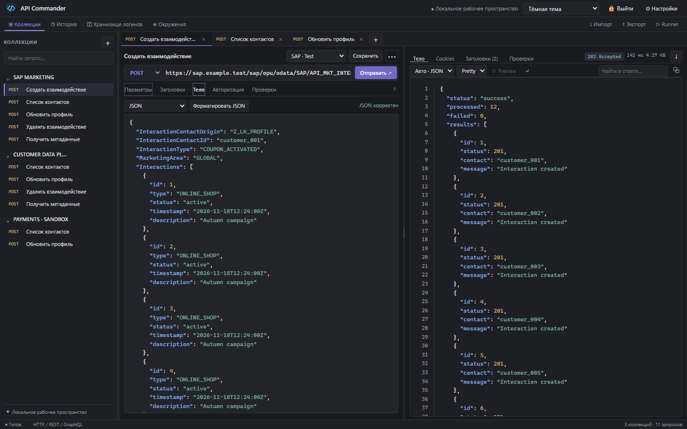
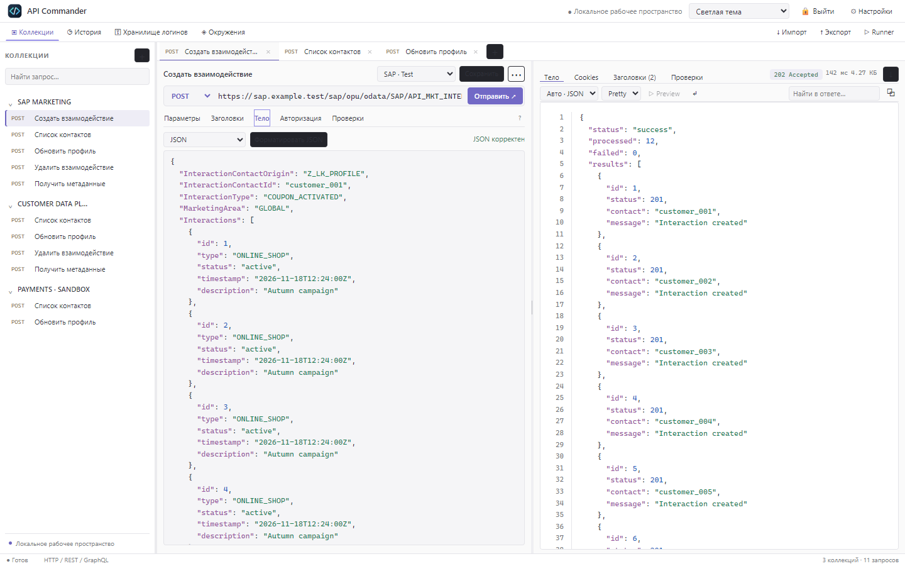
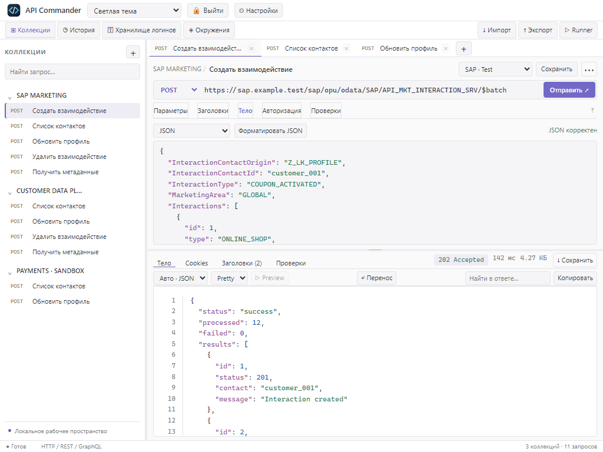
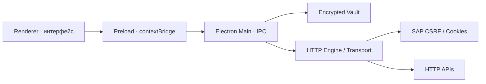

# API Commander

**🇷🇺 Русский** · [🇬🇧 English](README.en.md)

**API Commander** — десктопный HTTP API-клиент для Windows, созданный для повседневной работы с REST API, коллекциями запросов и SAP OData. Рабочее пространство хранится локально: не нужны регистрация, облачный аккаунт или отдельный сервер.

**[⬇ Скачать API Commander для Windows](https://github.com/evgsnr/api-commander/releases/latest)** · [Все релизы](https://github.com/evgsnr/api-commander/releases)

## Интерфейс

| Тёмная тема | Светлая тема |
|:---:|:---:|
|  |  |

Компактный режим

## Для каких задач

- **Повседневная работа с HTTP API:** запросы, параметры, заголовки, тела и просмотр ответов.
- **Работа системного аналитика:** коллекции, окружения, переменные `{{name}}`, история, импорт готовых запросов.
- **Интеграции с SAP Marketing / OData:** предварительное получение CSRF-токена, работа с cookies и повторное использование токена.
- **Локальные рабочие пространства:** данные остаются на компьютере, без обязательной облачной синхронизации.

## Возможности

| Область | Реализовано |
|---|---|
| HTTP | GET, POST, PUT, PATCH, DELETE, HEAD, OPTIONS; таймауты, отмена, redirects |
| Тела запросов | JSON, XML/текст, URL-encoded, GraphQL через HTTP, multipart, бинарные файлы |
| Авторизация | Basic, Bearer, API Key; профили Basic-учётных данных |
| Организация | Коллекции, вложенные папки, окружения, поиск, история, drag-and-drop |
| Импорт | Postman Collection v2, Postman environments, OpenAPI JSON, cURL |
| Ответы | JSON/XML/HTML/Text, Pretty/Raw, поиск, заголовки, cookies, HTML preview |
| Автоматизация | Декларативные проверки ответов и последовательный Runner |
| SAP OData | Автоматический/ручной CSRF fetch, cookie-сессии и кеш токенов |
| Хранение | Локальный зашифрованный профиль, блокировка и автоблокировка |

## Что изменилось в v2.1.0 — Calm UI

Переработан интерфейс: компактнее элементы управления, больше пространства для редактора, светлая и тёмная темы, а также адаптивное размещение запроса и ответа — рядом или друг под другом.

[История выпусков и файлы для скачивания](https://github.com/evgsnr/api-commander/releases)

## Установка

1. Перейди в **[последний релиз](https://github.com/evgsnr/api-commander/releases/latest)** и скачай ZIP-архив Windows Portable.
2. Распакуй архив целиком в отдельную папку.
3. Запусти `API Commander.exe`.

**Обновление:** закрой приложение и сохрани пользовательские данные (в частности, папку `data`) при замене файлов. Не запускай EXE отдельно от остальных файлов Portable-сборки.

## Архитектура

Приложение построено на **Electron / Node.js**. Интерфейс работает в Renderer, привилегированные операции выполняются в Main через ограниченный IPC-мост. Запросы обрабатываются HTTP-движком; локальные данные хранятся в зашифрованном рабочем пространстве.

## Важные ограничения

- Нет OAuth 2.0 flow, gRPC, WebSocket, облачной синхронизации и выполнения Postman scripts.
- Импорт OpenAPI поддерживает JSON и не покрывает все возможности спецификации; специализированного конструктора OData batch нет.
- Несохранённые изменения могут потеряться при аварийном завершении; восстановление забытого пароля не предусмотрено.
- В документации исходников описано шифрование AES-256-GCM с выводом ключа через scrypt, **но независимый аудит безопасности не проводился**. Экспортированные запросы и файлы могут содержать секреты.

## О разработке

Проект создан в формате **AI-assisted development**: автор прорабатывал продуктовую концепцию, требования, архитектуру и управлял реализацией с помощью AI-агентов. Это самостоятельный проект, а не заявление о ручном написании всего исходного кода.

**Обратная связь:** [сообщить о проблеме или предложить улучшение](https://github.com/evgsnr/api-commander/issues).
