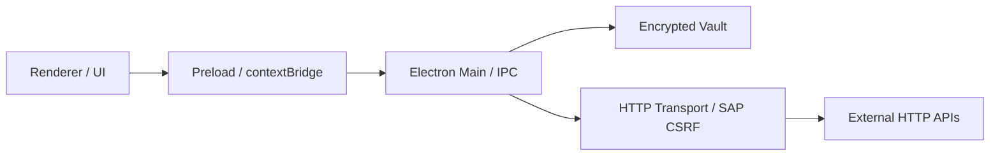

# API Commander

**🇷🇺 Русский** · [🇬🇧 English](README.en.md)

**API Commander** — локальный десктопный HTTP API-клиент для Windows. Инструмент для повседневной работы с API: запросы, окружения, коллекции, авторизация и интеграции SAP OData — без обязательного облачного аккаунта.

**Версия:** 2.1.0 · **Платформа:** Windows · **Технологии:** Electron, Node.js, JavaScript, HTML, CSS

## Что умеет

- **HTTP/HTTPS:** GET, POST, PUT, PATCH, DELETE, HEAD, OPTIONS; query-параметры, заголовки, таймауты, отмена запросов и redirects.
- **Коллекции и окружения:** вложенные папки, переменные `{{name}}`, история запросов.
- **Авторизация:** Basic, Bearer, API Key; локальные профили учётных данных с доступом по коллекциям.
- **SAP Marketing / OData:** автоматическое и ручное получение CSRF-токена, cookie-сессии и кеширование токенов.
- **Тела запросов:** JSON, текст/XML, URL-encoded, GraphQL query/variables, multipart и бинарные файлы.
- **Просмотр ответов:** форматирование, подсветка, поиск, заголовки, cookies, HTML preview.
- **Импорт:** Postman Collection v2, Postman environments, OpenAPI JSON, cURL и собственные рабочие пространства.
- **Проверки и Runner:** декларативные проверки ответов и последовательное выполнение коллекций.
- **Локальное хранение:** шифрование рабочего пространства, ручная блокировка и автоблокировка.

## Версия 2.1.0 — Calm UI

Компактный интерфейс со светлой и тёмной темами, приглушёнными акцентами, увеличенным пространством редактора и адаптивным расположением панелей запроса и ответа.

## Архитектура

Приложение использует Electron с разделением процессов:

- **Renderer:** интерфейс, коллекции, редактор, история и Runner.
- **Preload:** ограниченный мост между интерфейсом и привилегированным процессом.
- **Main:** IPC, жизненный цикл приложения, операции с файлами и сетью.
- **Vault:** локальное зашифрованное рабочее пространство.
- **Transport / Engine:** HTTP-запросы, авторизация, cookies, CSRF и проверки ответов.

Отдельный сервер, облачная регистрация и синхронизация не требуются.

## Установка

Windows Portable-сборка предназначена для запуска после распаковки архива. Сохраняйте файлы приложения вместе, а при обновлении — каталог пользовательских данных.

> Публичный релиз для скачивания будет добавлен отдельно. Сейчас репозиторий оформлен как страница проекта.

## Ограничения

Это не полная замена Postman: нет OAuth 2.0 flow, gRPC, WebSocket, облачной синхронизации и выполнения Postman scripts. OpenAPI поддерживается в формате JSON с ограниченным разбором схем; полноценный OData batch-конструктор отсутствует.

**Безопасность:** по исходному коду описано локальное шифрование AES-256-GCM с выводом ключа через scrypt. Это не утверждение о проведённом независимом аудите. Черновики могут теряться при аварийном завершении, а забытый пароль восстановить нельзя.

## Как создавался проект

API Commander создавался с использованием **AI-assisted development**. Автор отвечал за концепцию, требования, архитектурные решения, управление разработкой и проверку результата; реализация кода выполнялась с помощью AI-агентов.

---

*API Commander — меньше лишнего, больше работы с API.*
